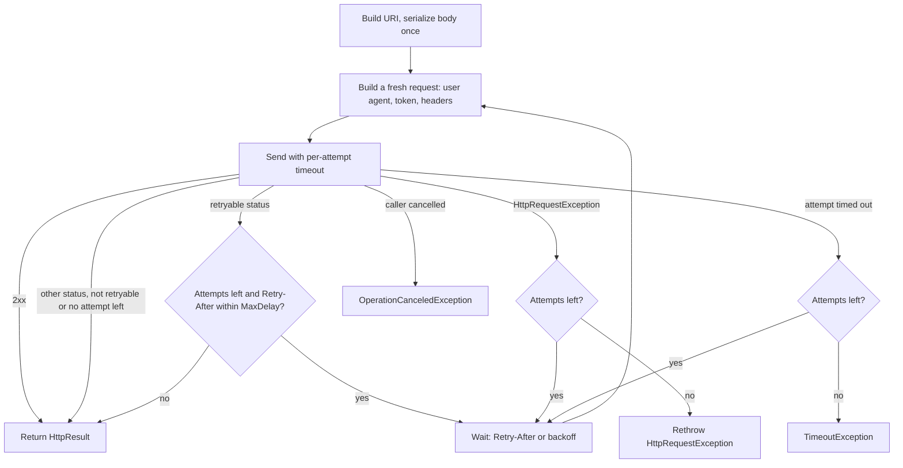

# Design notes

Why `SFerrand.Http` works the way it does. Each section states the decision, the reason, and what was rejected, so a
change can be judged against the original intent.

## Goals and non-goals

**Goals**: make the typical API client a few lines long; be correct under concurrency with a shared `HttpClient`; make failure
handling explicit and predictable; stay small.

**Non-goals** (use the platform or a dedicated library): circuit breaking and bulkheads, response caching, pagination
helpers, streaming or file download, request/response body logging, OAuth flows (you supply the token).

## Overview of a call

A 2xx response whose body is not valid JSON for the requested type throws `JsonException` and is not retried.

## Decisions

### 1. HTTP errors are values, exceptions are for the exceptional

`HttpResult<T>` carries the status, headers, raw body and deserialized body. A 404 or 422 is an expected outcome of talking
to an API, and callers usually need the *error body* to react; an exception would force `try/catch` around business logic
and lose the payload. Exceptions remain for what the caller cannot handle locally: transport failure, timeout, cancellation,
malformed success body.

*Rejected*: `EnsureSuccessStatusCode()` (loses the body), a custom exception carrying the response (still control flow).

### 2. Retries are conservative by default

- Retried: `408, 429, 500, 502, 503, 504`, `HttpRequestException`, and attempt timeouts.
- Only **idempotent** methods (`GET`, `HEAD`, `OPTIONS`, `PUT`, `DELETE`). A `POST` whose response was lost may have
  succeeded; replaying it can create a duplicate. Opting in is one property (`RetryNonIdempotentMethods`).
- **Exponential backoff with "equal jitter"**: `delay = capped/2 + random(0, capped/2)`. Compared with full jitter it keeps a
  guaranteed minimum wait (so a struggling server is not hit again immediately) while still desynchronizing clients.
- **`Retry-After` wins over the backoff**, in seconds or date form. If it exceeds `MaxDelay` the response is returned at once:
  sleeping for an hour inside a request is never what the caller wants, and retrying earlier than asked is rude.
  A zero, negative or past value carries no information and falls back to the backoff.
- The request body is serialized **once** and the same bytes are replayed; the request *message* is rebuilt for every
  attempt (a message cannot be sent twice), which also re-evaluates token and header factories, so a retry can use a
  refreshed token.

### 3. Timeouts are per attempt and distinguishable from cancellation

`HttpClient.Timeout` is global and surfaces as an anonymous `TaskCanceledException`. Here each attempt gets a linked
`CancellationTokenSource` armed with `RequestTimeout`. In the `catch`, "the caller's token is not cancelled" means "our timeout
fired" and is retried, then reported as a `TimeoutException` naming the URL; if the caller's token is cancelled, the
`OperationCanceledException` propagates untouched, including during the wait between attempts. Callers can therefore tell
"the server is slow" from "I asked to stop".

### 4. Nothing is stored on the shared `HttpClient`

Authentication and headers are set on each `HttpRequestMessage`, never on `DefaultRequestHeaders` or `BaseAddress`.
`IHttpClientFactory` hands out clients that are pooled and shared across threads; mutating them leaks one caller's state
into another's request, accumulates duplicate header values, and prevents token refresh. Token and header values are
therefore *factories* evaluated per request. Content headers (`Content-Type`, ...) cannot live on the request headers in
.NET (adding them throws), so they are routed to the content; for a request without a body they are ignored.

### 5. URLs are built by one predictable rule

`BaseAddress` semantics depend on trailing and leading slashes (`new Uri(base, "/x")` discards the base path). Instead the
resource is **always appended** to the configured base, whatever the slashes; an absolute resource replaces the base.
Identifiers become path segments (`/` splits segments, each is URL-encoded), query parameters are URL-encoded in order.
Base addresses must be absolute **http(s)**: on Unix `Uri.TryCreate("/v1", UriKind.Absolute, ...)` succeeds and yields
`file:///v1`, which must not be mistaken for a valid base.

### 6. Logs never contain secrets

Method, URL **without its query string**, status and duration are logged; bodies and credentials never are. Query strings often
carry tokens or signed values, so the safe default is to drop them everywhere (log messages and `TimeoutException` text).

### 7. JSON defaults to the web profile

`JsonSerializerDefaults.Web` (camelCase, case-insensitive reads) is what most HTTP APIs speak. Bodies are serialized with the
**runtime type** of the object, not the declared `object`, otherwise an anonymous or derived body would serialize as `{}`.
`HttpResult<string>` skips parsing and keeps the raw body, for plain-text or HTML responses.

### 8. A small, protected API surface

The verbs are `protected`: the library is a base class for *your* client, whose public methods express your domain
(`GetWidgetAsync`), not generic HTTP. Every verb is a thin wrapper over `SendAsync`, which is also the extension point (override it
to add correlation headers or metrics around every call). A copy constructor lets several focused clients share one configuration.

### 9. `SimpleHttpClientFactory`

A thread-safe, cached `IHttpClientFactory` for tests, scripts and console tools, with an injectable `HttpMessageHandler`
(so a stub is enough to test a client end to end). It disposes the clients it created, not the handler it was given.
In a hosted application use `AddHttpClient()`, which also manages handler lifetime and DNS refresh.

## Trade-offs and known limits

- `DeleteAsync` returns only a `bool`; use `SendAsync` when you need the status or error body.
- Pagination is not followed; `ListAsync` deserializes one JSON array.
- Per-attempt timeouts mean the worst-case duration of a call is roughly
  `(MaxRetries + 1) × RequestTimeout + Σ delays`; budget accordingly or use the caller's `CancellationToken` as an overall deadline.
- GraphQL errors typically come back as `200 OK` with an `errors` array: inspect your envelope type, not only `IsSuccess`.
