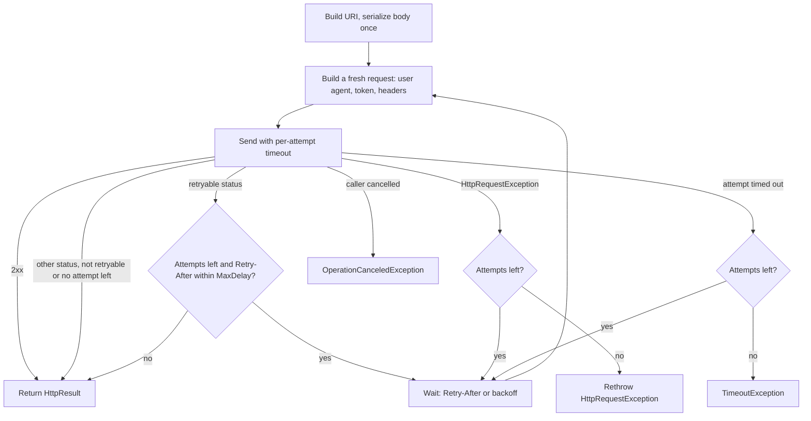

# Design notes

Why `SFerrand.Http` works the way it does. Each section states the decision, the reason, and what was rejected, so a
change can be judged against the original intent.

## Goals and non-goals

**Goals**: make the typical API client a few lines long; be correct under concurrency with a shared `HttpClient`; make failure
handling explicit and predictable; stay small.

**Non-goals** (use the platform or a dedicated library): circuit breaking and bulkheads, response caching, pagination
helpers, streaming or file download, request/response body logging, OAuth flows (you supply the token).

## Overview of a call

A 2xx response whose body is not valid JSON for the requested type throws `JsonException` and is not retried.

## Decisions

### 1. HTTP errors are values, exceptions are for the exceptional

`HttpResult<T>` carries the status, headers, raw body and deserialized body. A 404 or 422 is an expected outcome of talking
to an API, and callers usually need the *error body* to react; an exception would force `try/catch` around business logic
and lose the payload. Exceptions remain for what the caller cannot handle locally: transport failure, timeout, cancellation,
malformed success body.

*Rejected*: `EnsureSuccessStatusCode()` (loses the body), a custom exception carrying the response (still control flow).

### 2. Retries are conservative by default

- Retried: `408, 429, 500, 502, 503, 504`, `HttpRequestException`, and attempt timeouts.
- Only **idempotent** methods (`GET`, `HEAD`, `OPTIONS`, `PUT`, `DELETE`). A `POST` whose response was lost may have
  succeeded; replaying it can create a duplicate. Opting in is one property (`RetryNonIdempotentMethods`).
- **Exponential backoff with "equal jitter"**: `delay = capped/2 + random(0, capped/2)`. Compared with full jitter it keeps a
  guaranteed minimum wait (so a struggling server is not hit again immediately) while still desynchronizing clients.
- **`Retry-After` wins over the backoff**, in seconds or date form. If it exceeds `MaxDelay` the response is returned at once:
  sleeping for an hour inside a request is never what the caller wants, and retrying earlier than asked is rude.
  A zero, negative or past value carries no information and falls back to the backoff.
- The request body is serialized **once** and the same bytes are replayed; the request *message* is rebuilt for every
  attempt (a message cannot be sent twice), which also re-evaluates token and header factories, so a retry can use a
  refreshed token.

### 3. Timeouts are per attempt and distinguishable from cancellation

`HttpClient.Timeout` is global and surfaces as an anonymous `TaskCanceledException`. Here each attempt gets a linked
`CancellationTokenSource` armed with `RequestTimeout`. In the `catch`, "the caller's token is not cancelled" means "our timeout
fired" and is retried, then reported as a `TimeoutException` naming the URL; if the caller's token is cancelled, the
`OperationCanceledException` propagates untouched, including during the wait between attempts. Callers can therefore tell
"the server is slow" from "I asked to stop".

### 4. Nothing is stored on the shared `HttpClient`

Authentication and headers are set on each `HttpRequestMessage`, never on `DefaultRequestHeaders` or `BaseAddress`.
`IHttpClientFactory` hands out clients that are pooled and shared across threads; mutating them leaks one caller's state
into another's request, accumulates duplicate header values, and prevents token refresh. Token and header values are
therefore *factories* evaluated per request. Content headers (`Content-Type`, ...) cannot live on the request headers in
.NET (adding them throws), so they are routed to the content; for a request without a body they are ignored.

### 5. URLs are built by one predictable rule

`BaseAddress` semantics depend on trailing and leading slashes (`new Uri(base, "/x")` discards the base path). Instead the
resource is **always appended** to the configured base, whatever the slashes; an absolute resource replaces the base.
Identifiers become path segments (`/` splits segments, each is URL-encoded), query parameters are URL-encoded in order.
Base addresses must be absolute **http(s)**: on Unix `Uri.TryCreate("/v1", UriKind.Absolute, ...)` succeeds and yields
`file:///v1`, which must not be mistaken for a valid base.

### 6. Logs never contain secrets

Method, URL **without its query string**, status and duration are logged; bodies and credentials never are. Query strings often
carry tokens or signed values, so the safe default is to drop them everywhere (log messages and `TimeoutException` text).

### 7. JSON defaults to the web profile

`JsonSerializerDefaults.Web` (camelCase, case-insensitive reads) is what most HTTP APIs speak. Bodies are serialized with the
**runtime type** of the object, not the declared `object`, otherwise an anonymous or derived body would serialize as `{}`.
`HttpResult<string>` skips parsing and keeps the raw body, for plain-text or HTML responses.

### 8. A small, protected API surface

The verbs are `protected`: the library is a base class for *your* client, whose public methods express your domain
(`GetWidgetAsync`), not generic HTTP. Every verb is a thin wrapper over `SendAsync`, which is also the extension point (override it
to add correlation headers or metrics around every call). A copy constructor lets several focused clients share one configuration.

### 9. `SimpleHttpClientFactory`

A thread-safe, cached `IHttpClientFactory` for tests, scripts and console tools, with an injectable `HttpMessageHandler`
(so a stub is enough to test a client end to end). It disposes the clients it created, not the handler it was given.
In a hosted application use `AddHttpClient()`, which also manages handler lifetime and DNS refresh.

## Security decisions

A security review of the first version turned up the issues below. Each was reproduced by a test that failed on that version, then fixed; two were also reproduced on a real
connection before the fix, because they depended on what the framework does and a stub would only have shown what I believed it did.

1. **A client that holds credentials must know where it may send them.** The resource and a per-call `baseUri` are often built from outside data; an absolute URL used to *replace*
   the base address, token and default headers included. Now an origin (scheme, host, port, compared case-insensitively with default ports normalized) is trusted only if it is the base address,
   the GraphQL endpoint, or declared in `TrustedOrigins`. Anything else is refused *before* sending. The same check is applied to the origin the response finally came from.
   *Rejected*: silently dropping the credentials for foreign origins (it hides a bug behind a 401, and does nothing against server-side request forgery).
2. **Header values are added without validation, so they must be validated here.** `TryAddWithoutValidation` is used so that unusual formats work. It also lets a line break through: on a real connection
   `"ok\r\nX-Injected: 1"` reached the server as a second header. Names must be HTTP tokens (an invalid one used to be dropped *silently*, as the result of the add was ignored), values (default, per call,
   token, user agent) may not contain control characters other than a tab, and the headers that frame the message are refused. Error messages never repeat a value: it may be a credential.
3. **Clear text is opt-in.** `http://` is accepted on the loopback interface (development, tests) or with `AllowInsecureHttp`. The check happens when the client is built, so a bad configuration fails at
   startup, not on the first production call.
4. **`Uri` resolves dot segments.** `"../../admin"` as an identifier climbed out of the resource and reached another endpoint with the application's credentials. Whole `.` and `..` segments are
   refused, also as `%2e` and with `\` (some servers treat it as a separator), in both the resource and the identifier. A literal `%2e%2e` in an identifier is data and stays escaped. A fragment in a
   resource is refused too: it would swallow the identifier and the parameters.
5. **Nothing secret in an address, a message or a log.** Credentials in an address are refused; logs use scheme, host and path only (the old code logged the user info along with the path); messages describe an address
   by scheme, host and port at most.
6. **Bounded memory.** The body is read after the headers, in chunks, and cut off at `MaxResponseBytes`; a declared length over the limit is refused without reading. The limit error is a dedicated exception that is *not*
   a `HttpRequestException`, because transport errors are retried and downloading a body that is too large again would only repeat the problem. The attempt timeout covers the body, so a stalled body cannot hang the call.
7. **Redirects cannot be fully controlled from here.** Measured on the framework used: a cross-origin redirect drops `Authorization` but keeps every other header, so an `X-Api-Key` or a `Cookie` follows. The client does not own
   the handler, so it cannot forbid redirects. What it does: `SimpleHttpClientFactory` disables them, the README shows the same setting for `AddHttpClient`, and a response from an undeclared origin is never returned.
   A redirect-following layer that applies the origin rules at each hop is the clean answer, and is listed as future work.

### How the fixes were checked

Besides the regression tests, a hand-made mutation pass removes each guard in turn (39 mutations: every check above, every constant of the header and path rules, the boundary of the size limit, the
default of the factory) and requires a test to fail. The harness classifies by the **exit code** of the test run, and is validated with a mutation that does nothing (it must survive) as well as an obviously
wrong one (it must be killed). A first pass, with a harness that parsed the (localized) console text, reported every mutant as killed; the no-op control exposed it. Redone properly, ten real gaps appeared:
among them a comparison of origins that forgot the scheme (so the token could follow a downgrade from `https` to `http` on the same port) and a size test that also passed when the whole body was read before
being refused. All are now covered. One mutant survives by design: the log line would still be safe if it printed user info, because user info is refused earlier (defence in depth, equivalent behaviour).

## Features added after the first review

Each of these follows from something the review taught, or from a need the first version could not meet. They were built the same way as the fixes: tests first, then a
hand-made mutation pass to see whether the tests notice the guard being removed.

A pass of 149 mutations on this code (limits, hop rules, credentials, retries and keys, total timeout, pagination, `Link` parsing, problem documents, bodies, option validation, registration), then 18 on the
test double, was run with the same harness. The first run left 36 mutants alive or not compiling (a mutation that does not build proves nothing, so those were rewritten in a form that builds). The real gaps were
filled with tests; the rest were either simplified away or are equivalent:

- *a redirect to another scheme is not checked*: the origin check refuses it first;
- *a new idempotency key for each attempt*: the key is computed once, outside the attempt loop, so the mutant is the same program;
- *a zero total timeout is armed*: zero is refused when the options are validated, so the engine never sees it;
- *`TryAdd` instead of replace for the content headers of the recorded request* (test double): a content header never has the name of a request header;
- three mutants showed dead or redundant code, which was removed instead of tested: a test for `Timeout.InfiniteTimeSpan` that `<= TimeSpan.Zero` already covers, a fixed multipart boundary (the framework already
  draws a new random one for each instance), and a second "is it an object" test in the problem-document parser after the leading `{` had been checked.

### Redirects are followed by the client

The framework follows redirects behind the caller's back and keeps every custom header across origins (measured: only `Authorization` is dropped). The client cannot
switch that off on a handler it does not own, so it does the following itself and asks for a handler that does not (`AddSFerrandHttpClient` and `SimpleHttpClientFactory`
set it). Each hop is checked like a call, and **credentials stop at the first change of origin, for good**: coming back to the first origin later in the chain does not
bring them back. The method rules are the browsers' (a 303 is a `GET`; a 301 or 302 turns a `POST` into a `GET`; a 307 or 308 keeps method and body), with one addition:
a body is never re-sent to another origin, the redirect is returned instead. The rule applied at the end remains: whatever the handler did, an answer from an undeclared
origin is not returned.

### One engine, several kinds of call

`SendAsync`, forms, multipart and downloads all go through one private engine, which owns retries, redirects, timeouts, telemetry and logging. The kind of call only decides
the body (bytes plus a media type, built **once** so every attempt sends the same ones) and how the response is read. Pagination is built on `GetAsync`, so overriding it
still applies.

### The body is read after the headers, and that changes what a retry means

Reading the body under the attempt's timeout, in chunks, is what makes the size limit and the streamed download possible. It has a consequence found while testing: a
connection dropped in the middle of the body used to surface as an `HttpRequestException` (the framework buffered the body inside `SendAsync`) and now surfaces as an
`IOException`. The engine treats it as the same transient failure, and reports it as an `HttpRequestException` when attempts run out, so callers see no difference. Checked
on a real connection, since the exact type depends on the framework. A download that has already written bytes is the exception: replaying would corrupt the destination,
so it raises `DownloadInterruptedException`, which the engine never retries.

### Idempotency keys instead of "retry POST and hope"

`RetryNonIdempotentMethods` is a blunt tool. With an idempotency key, the **same** key travels on every attempt of a call and a server that honours it can recognize the
replay. The key is generated once per call, a key supplied by the caller wins and also makes the call retryable, and the feature is off by default because a server that
ignores the header would execute the replay.

### Errors, GraphQL and pagination read what the server says without trusting it

`ProblemDetails` is parsed with `JsonDocument` (so it is AOT-safe, never throws, and rejects a deeply nested document), and a JSON error of another shape is not mistaken for
one. `ApiException` keeps the raw body on a property and **out of its message**. A GraphQL `200` carrying `errors` is a result with errors, surfaced by `EnsureNoErrors()`.
In pagination the next address comes from the server: it gets the same checks as any call, a loop is detected, and hitting the page limit throws rather than truncating.

### Telemetry records addresses without their query

Spans and metrics use the same safe form of an address as the logs. A span covers the logical call; the framework's own spans for each request are its children.
Metric names are the library's own (`sferrand.http.client.*`) so they cannot be confused with the framework's per-request `http.client.*` metrics.

### Trimming and native AOT

The only reflective call was in the JSON handling. Metadata now comes from `JsonTypeInfo`, resolved from the options; reflection is used only when the application allows it
(`JsonSerializer.IsReflectionEnabledByDefault`, a feature switch the trimmer understands). A type the supplied context does not know is refused rather than read by reflection, and a
missing resolver is explained. One real-world detail: `ListAsync<T>` reads an `IEnumerable<T>`, which the context must declare.

### Options are validated once, in one place

The same rules run when a client is built (which throws) and through `IValidateOptions` (which lets the host refuse to start). Messages report every problem and never more
than scheme, host and port of an address.

## Trade-offs and known limits

- `DeleteAsync` returns only a `bool`; use `SendAsync` when you need the status or error body.
- Pagination is not followed; `ListAsync` deserializes one JSON array.
- Per-attempt timeouts mean the worst-case duration of a call is roughly
  `(MaxRetries + 1) × RequestTimeout + Σ delays`; budget accordingly or use the caller's `CancellationToken` as an overall deadline.
- Redirects are followed by the client only if the handler does not follow them itself (see "Redirects" above); a handler that does gives the leak back, and the client can only refuse the answer.
- Multipart bodies and idempotency-keyed bodies are held in memory so that they can be replayed; very large uploads should use an `HttpClient` directly.
- The retry policy is a simple one. For circuit breaking, hedging or rate limiting, compose with `Microsoft.Extensions.Http.Resilience` (`AddSFerrandHttpClient` returns the builder); mind not to stack two retry layers.
- GraphQL errors typically come back as `200 OK` with an `errors` array: inspect your envelope type, not only `IsSuccess`.
